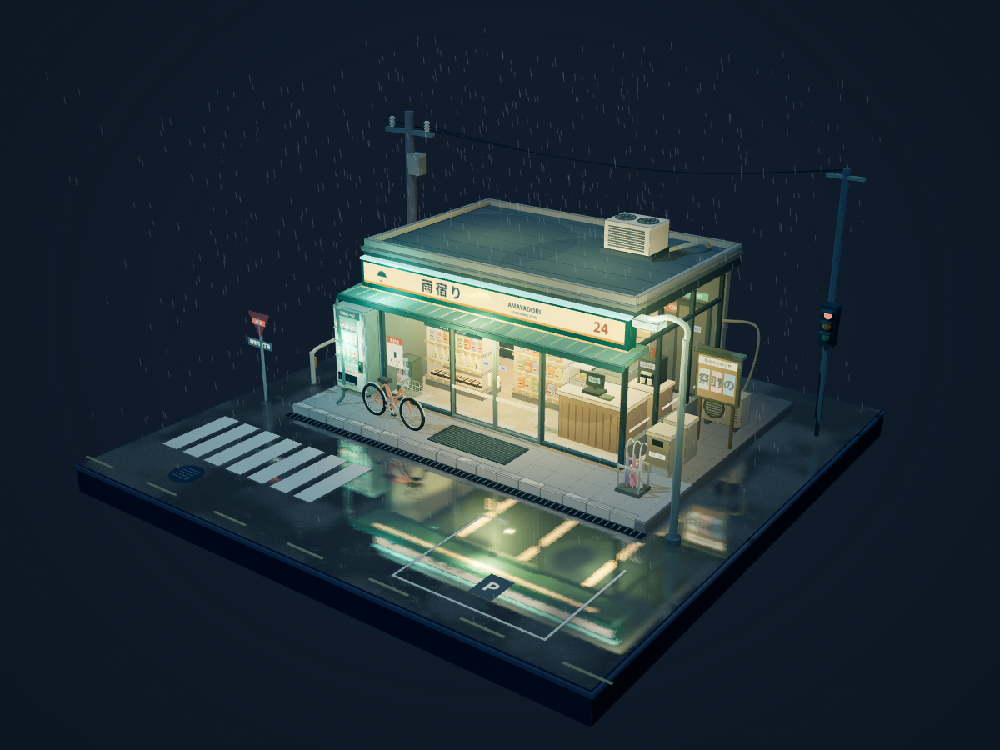

# 雨宿り · Rainy Corner

一个可旋转、缩放的雨夜便利店微缩三维场景，使用 HTML 和 Three.js。没有人物和界面按钮，所有设施搭建在完整的正方形底座上。



## 场景

- 冷色街道与暖色便利店照明，分层卡通材质和轮廓线。
- 正面与侧面的玻璃窗；饭团、便当、零食、饮料柜、收银台、咖啡机、关东煮、杂志架、冰柜和后场门。
- 接地的贩卖机、自行车和车撑、雨伞架、分类垃圾桶、路灯、电线杆、护栏、公告栏和空调外机。
- 带雨水扰动的实时路面倒影、持续降雨、扩散波纹、檐口滴水、玻璃雨痕、招牌微弱闪烁和交通信号变化。
- 自动门每 22 秒缓慢开合一次。雨滴会避开店内，在屋顶和雨棚处截断。

## 运行

项目已包含全部 JavaScript 依赖，无需 npm 安装。安装 Python 3，在项目目录运行：

```sh
python3 -m http.server 3000
```

Windows 可用 `python -m http.server 3000`。然后在浏览器中打开 `http://localhost:3000`。需要支持 WebGL 的现代浏览器，请通过 HTTP 服务打开，不要直接双击 `index.html`。

也可使用 `npm run start`（需要 Node.js 和 Python 3）。

## 操作

鼠标左键拖拽旋转，滚轮缩放；触屏单指旋转、双指缩放。桌面与手机竖屏都会自动调整初始构图。

## 验证

`npm run check` 检查 JavaScript 语法。

通过 Chromium 实际渲染并检查桌面、旋转放大和手机竖屏画面；浏览器检查覆盖物件接地、鼠标旋转、滚轮缩放、自动门开合、资源加载与 JavaScript 错误。`preview.png` 为实际网页渲染截图。

路面倒影会增加 GPU 工作量。静态模型按材质合并，以减少绘制调用；高分屏像素比限制为 1.75。

## 第三方许可

`vendor/` 中的 Three.js r160、OrbitControls、Reflector 和 BufferGeometryUtils 使用 MIT 许可证，详见 `vendor/LICENSE`。
